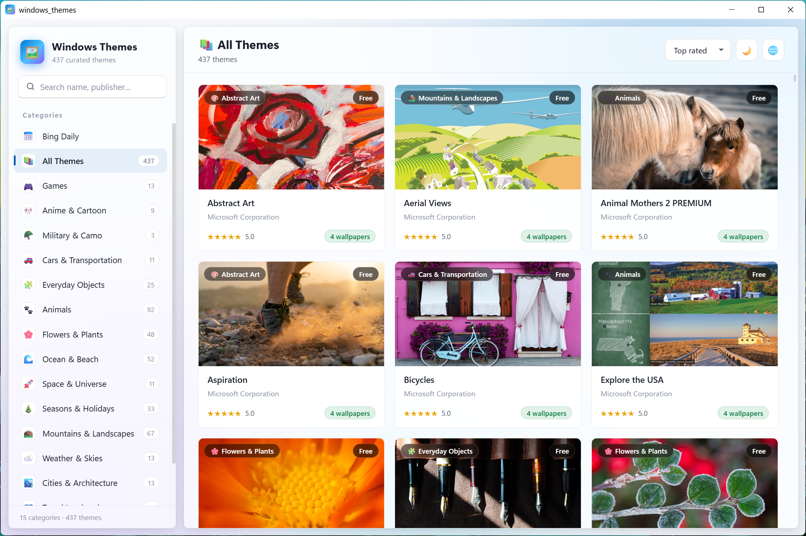
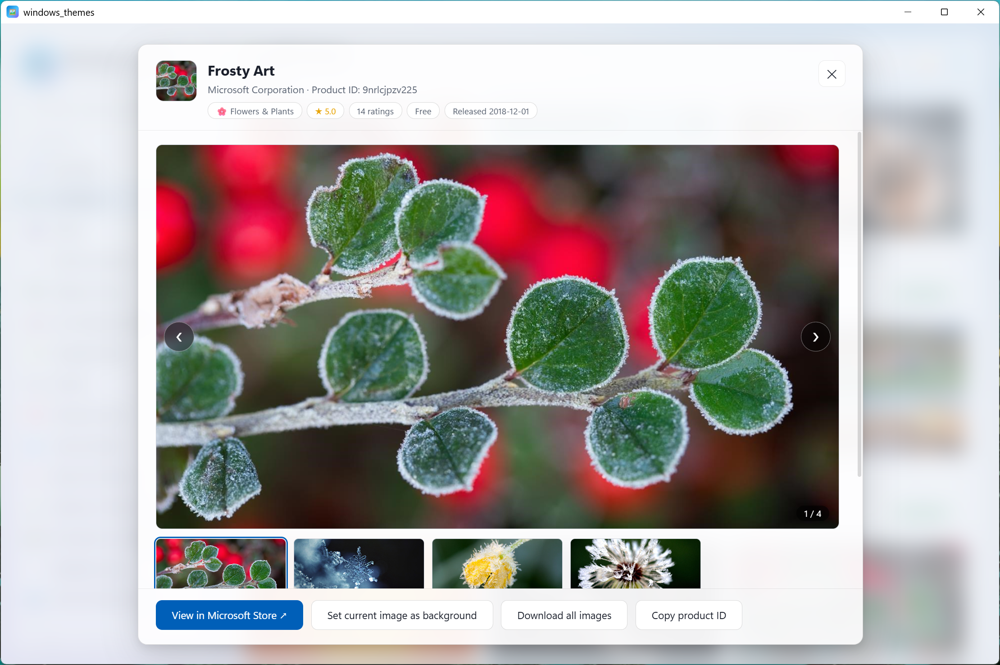

# Windows 主题库

用于浏览、搜索和查看规划中的 Windows 桌面主题库。它包含多个按类别整理的内置主题，并支持在浅色和深色主题之间切换。

[在线体验](https://lightlytech.github.io/UI-Designer-for-AI-Prompt-Generation/)

## 功能特性

### 主题浏览
- 包含 437 个精选 Windows 主题
- 按 16 个类别浏览：
  - 游戏
  - 动漫与卡通
  - 军事与迷彩
  - 汽车与交通工具
  - 日常物品
  - 动物
  - 花卉与植物
  - 海洋与海滩
  - 太空与宇宙
  - 季节与节日
  - 山脉与风景
  - 天气与天空
  - 城市与建筑
  - 旅行地标
  - 抽象艺术
  - 其他
- 侧边栏显示所有类别及每个类别中的主题数量
- “全部主题”视图可浏览整个主题集合
- 主题卡片显示封面图片、名称、发布者、评分、壁纸数量以及免费/付费标签
- 在“全部主题”视图中，卡片还会显示其类别标签

### 搜索与排序
- 按主题名称、发布者和描述进行实时搜索
- 搜索框支持一键清除
- 多种排序选项：
  - 评分最高
  - 评分人数最多
  - 最新
  - 名称 A→Z
- 未找到匹配主题时显示空状态提示

### 主题详情
- 点击主题卡片打开详情面板
- 显示主题图标、名称、发布者、产品 ID、类别、评分、评分人数、价格和发布日期
- 显示主预览图和最多 8 张附加预览图
- 显示完整的主题描述
- 显示壁纸数量、评分、评分人数、价格、发布日期和产品 ID 的信息卡片
- 支持在 Microsoft Store 中打开该主题
- 支持复制产品 ID，并提供成功/失败 toast 提示反馈

### 图片查看
- 点击详情面板中的任意预览图可打开全屏图片查看器
- 点击可关闭全屏查看器
- 按 `Esc` 可关闭详情面板和图片查看器

### 个性化
- 浅色/深色主题切换
- 浅色和深色模式使用不同的颜色、阴影和背景效果
- 中文/英文界面语言切换
- 切换语言后，导航、标题、搜索框、排序选项、详情信息和 toast 提示会相应更新
- 英文模式可显示主题的英文描述

### 交互体验
- 主题卡片在悬停时上浮并显示阴影
- 主题卡片交错入场动画
- 搜索框聚焦时底部高亮
- 语言下拉菜单带当前语言指示器
- 操作反馈的 toast 通知
- 键盘快捷键：
  - `/` 聚焦搜索框
  - `Esc` 关闭覆盖层

### 响应式布局
- 桌面布局采用侧边栏加主内容区域
- 移动端布局自动切换为堆叠布局
- 主题网格自适应屏幕宽度
- 详情面板和图片查看器适配小屏幕
